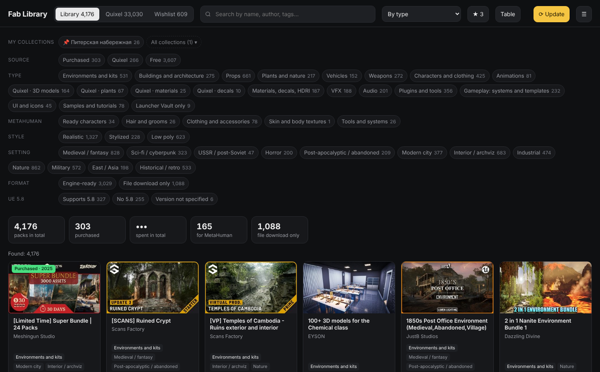
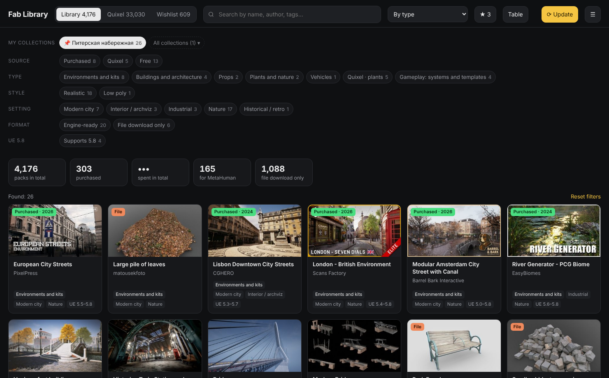
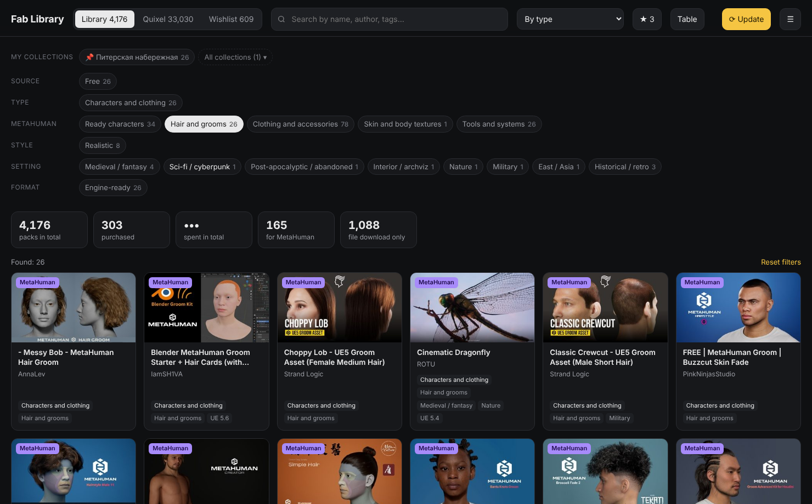
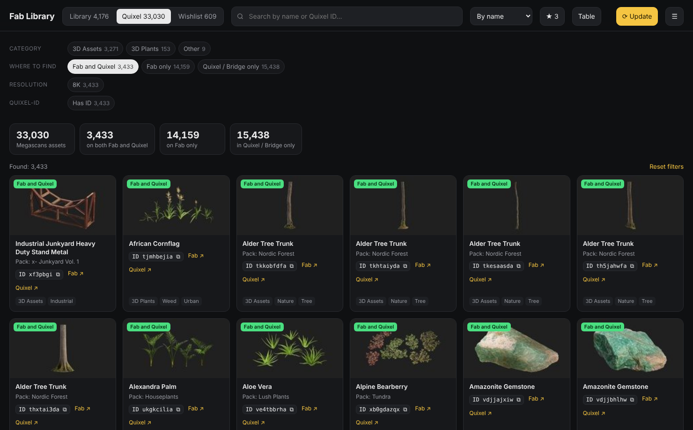
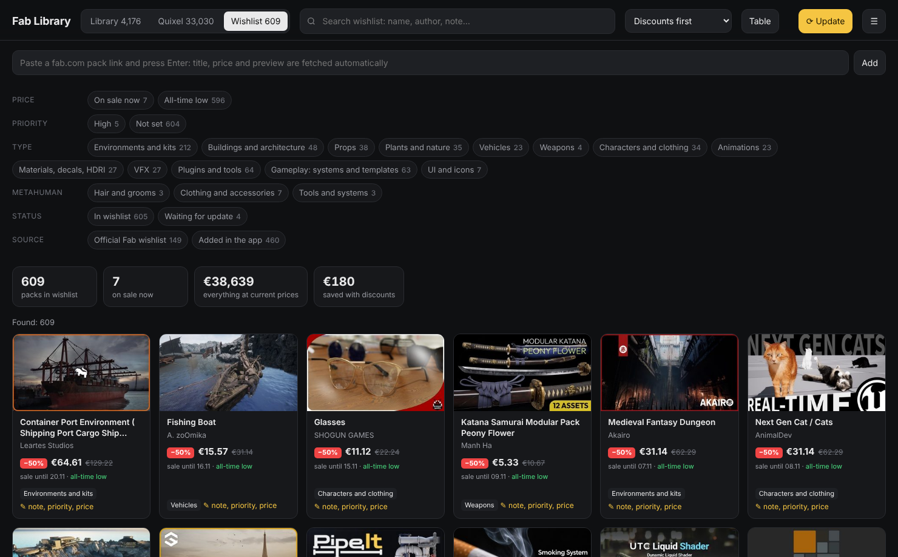

# Fab Library

English · [Русский](README.md)

Fab Library is a Windows desktop app. It gathers all your Fab.com assets, old Unreal Marketplace purchases, your Quixel Megascans library and your wishlist into one offline catalog with filters.



## Why

I work in Unreal Engine, and over a few years I collected more than 4,000 packs on Fab and almost 19,000 Quixel assets. The My Library page on Fab shows them as one long feed: you can't filter by style or setting, Megascans from the old quixel.com don't appear there, and the official wishlist has a size limit. Finding the right pack for a specific scene took too long, so I built this app.

What it does:

- shows your whole Fab library, including packs bought back on Unreal Marketplace, and totals your spending from the Epic order history;
- sorts packs by type, style (realistic, stylized, low poly), setting and format;
- highlights everything for MetaHuman: ready characters, hair and grooms, clothing, skin textures, animations and tools;
- for plugins, shows whether they support the latest engine version (currently UE 5.8);
- merges Quixel assets from the old quixel.com and from Fab into one tab with Bridge-style categories. Each asset shows its Quixel ID for searching in Bridge or on Fab, and a label telling you where to find it;
- keeps a wishlist with no size limit. You add a pack by pasting a link, and the app tracks prices, discounts and the all-time low;
- stores pack collections for your projects, for example "Saint Petersburg embankment";
- works offline after the first load. Updates run when you press a button.

The interface is available in Russian, English, Spanish, German, French and Chinese.

## Screenshots

A collection for a project:



MetaHuman assets:



Quixel: assets available on both Fab and quixel.com:



Wishlist with discounts:



## Installation

You need Windows 10 or 11 and about 300 MB of free space.

1. Download the archive with Code → Download ZIP on the repository page and unpack it to any folder, preferably a path without spaces, for example `D:\FabLibrary`.
2. Run `Запуск.bat` (it means "Start"). On the first run the script downloads portable Node.js 22 LTS (about 30 MB) from nodejs.org, checks its checksum and installs Electron (about 100 MB). Everything goes inside the app folder; your system is not changed. Later runs start right away.
3. Click "Sign in and load my library". Sign-in windows for Fab, the Epic purchase history and quixel.com open one after another. You type your login and password yourself on the real sites.

The first load takes 15–30 minutes, later ones a couple of minutes. If loading stops, run the update again and it continues from where it stopped.

## Usage

Filters on each tab combine: for example, "Characters and clothing" + "Realistic" + "Supports 5.8". Clicking a Quixel ID copies it to the clipboard. The ☰ menu lets you change the language, turn on wishlist price updates at startup, export the current list to CSV and open the data folder.

Collections live in `custom-filters.json` in the profile folder. Pinned collections and up to three new ones stay visible; the rest are hidden under "All collections", where you can search, pin or delete them. You can edit the file by hand or ask an AI assistant to build a collection from a description (see the next section): the app notices the change and refreshes the window.

```json
{ "version": 1, "items": [
  { "id": "spb-embankment", "name": "Saint Petersburg embankment", "tab": "lib", "pinned": true,
    "created": "2026-11-05", "note": "granite, bridges, trees by the water",
    "ids": ["<Fab listing id>", "<Quixel ID>"] }
] }
```

`tab` can be `lib`, `qx`, `wish` or `all`.

## Connecting an AI assistant

The app works fine without AI. An assistant helps when you want to find packs from a scene description, count something across your library or build a collection for a project. The steps below are for Claude in the desktop app; other assistants that can read files on disk work the same way.

### Step 1. Load your library

Install the app and click "Sign in and load my library" once (see "Installation"). Until the first load finishes, there is nothing for the assistant to read.

### Step 2. Find the profile folder

In the app, open the ☰ menu → "Open data folder". A folder like `C:\Users\<name>\AppData\Roaming\Fab Library\profiles\<Epic account ID>` opens. Copy the path from the Explorer address bar.

Give the assistant access to this folder only. Sign-in cookies are stored one level up, in `Fab Library\Partitions`, and never end up in the profile folder. Don't share the whole `Fab Library` folder.

### Step 3. Grant folder access

In Claude for desktop, start a new chat and ask it to open the folder at the path you copied. Claude asks for permission; confirm it. If your assistant can't work with folders, attach the files to the message manually: `library.json` is usually enough, add `quixel.json` for Quixel questions.

### Step 4. Send the first message

Copy the text below and replace `<path>` with the profile folder path. It tells the assistant where each kind of data lives and how to write collections.

```text
The folder <path> contains data from Fab Library, an offline catalog of my Fab and Quixel assets.
Files:
- library.json: my Fab packs: id, t (title), s (author), c (Fab category), tags, lt (listing type), ue (Unreal Engine versions), f (formats);
- purchases.json: Epic purchase history: totals, byYear, items (d = date, t = title, amt, cur);
- wishlist.json: wishlist: id, t, s, price, dp (sale price), pct (discount), hist (price history);
- quixel.json: quixel.com assets: qid (Quixel ID), t, cat (Bridge-style category), tags, pack, res;
- megascans-fab.json: Megascans on Fab: id, t, qid, own (true = I own it);
- user.json: favorites (fav) and wishlist notes (wish.meta);
- custom-filters.json: my collections.
Answer from these files and don't change them, except custom-filters.json.
Write a collection to custom-filters.json in this format:
{ "version": 1, "items": [ { "id": "latin-with-dashes", "name": "Title", "tab": "lib", "pinned": false, "created": "YYYY-MM-DD", "note": "short description", "ids": ["pack ids"] } ] }.
tab: lib = library (ids from library.json), qx = Quixel (qid or id from megascans-fab.json), wish = wishlist, all = all tabs.
Don't delete existing collections; append new ones to the end of items.
```

### Step 5. Ask questions

Example requests:

- "Make a collection for a Saint Petersburg embankment: granite, bridges, trees by the water";
- "Which of my plugins don't support UE 5.8?";
- "How much did I spend on packs in 2025?";
- "Find wet asphalt in 8K in Quixel and give me the Quixel IDs";
- "What in my wishlist is more than 40% off right now?";
- "Gather everything for a MetaHuman character in a business suit".

The assistant answers from the files and writes collections to `custom-filters.json`. If the app is open, a new collection appears by itself in the "My collections" row with a "new" label. After three days it moves into "All collections" unless you pin it with the star.

### Step 6. After an update

When you press "⟳ Update", the app overwrites the files in the profile folder. If a chat with the assistant is already open, ask it to reread the files; otherwise it will answer from the old data.

## Security and personal data

- The app never sees or stores your passwords. You sign in on the Fab, Epic and Quixel pages inside the app window; afterwards only the session cookies remain, in a separate Electron profile.
- All data stays on your computer in `%APPDATA%\Fab Library\profiles\<Epic account ID>\`. The app sends it nowhere and has no server of its own.
- Each Epic account gets its own folder, so you can give the app to someone else: they sign in with their account and see only their packs. The "Sign out and switch account" menu item clears the sign-in but keeps the data.
- Site windows run in a sandbox without Node.js access, pop-ups are allowed only over https, and camera, microphone and location requests are denied. Links open in the external browser only if they are http or https.
- The repository contains nobody's data. If you share your own copy, don't include the `%APPDATA%\Fab Library` folder: it holds your library, wishlist and sign-in cookies.

## Limitations

Fab and Quixel have no public API. The app makes the same requests the sites make in your browser, so after major site changes sync may stop working until the app is updated. Type, style and setting are detected automatically from tags and titles and are sometimes wrong.

Epic is gradually moving Quixel to Fab. While quixel.com still works, the app saves the list of your assets with their IDs locally, and it stays available offline. The app does not download the asset files themselves.

This is an unofficial project, not affiliated with Epic Games, Fab or Quixel. Use it at your own risk and within the terms of these services.

## Building a single exe

In the app folder, run:

```
runtime\node\node.exe runtime\node\node_modules\npm\bin\npm-cli.js run dist
```

A portable `Fab Library.exe` appears in the `dist` folder.

## Project structure

| File | Purpose |
|---|---|
| `main.js` | windows, sign-in, sync, preview cache, IPC |
| `sync.js` | reads library, purchases, wishlist and Megascans from Fab and Epic |
| `quixel.js` | reads the quixel.com library |
| `preload.js` | safe bridge between the window and the main process |
| `ui/` | interface: filters, cards, classification, translations |
| `tools/get-node.ps1` | downloads portable Node.js and verifies SHA-256 |

Translations are in `ui/i18n.js`; the key is the Russian string. To add a language, add a column to the string table.

If you want to build a similar app yourself with Claude, [PROMPT.md](PROMPT.md) contains a ready-made request.

## License

MIT, see [LICENSE](LICENSE).
