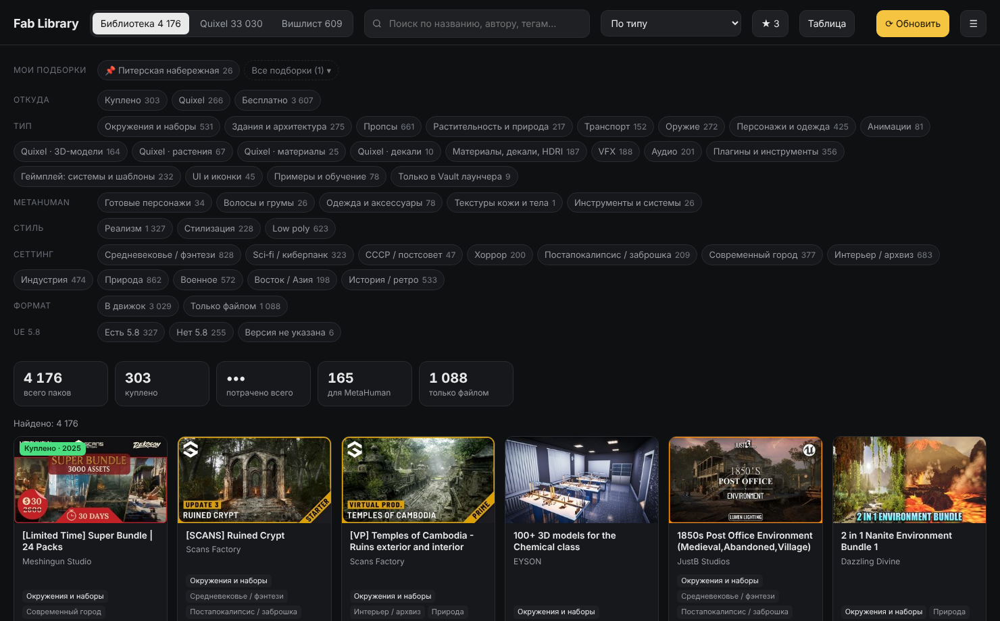
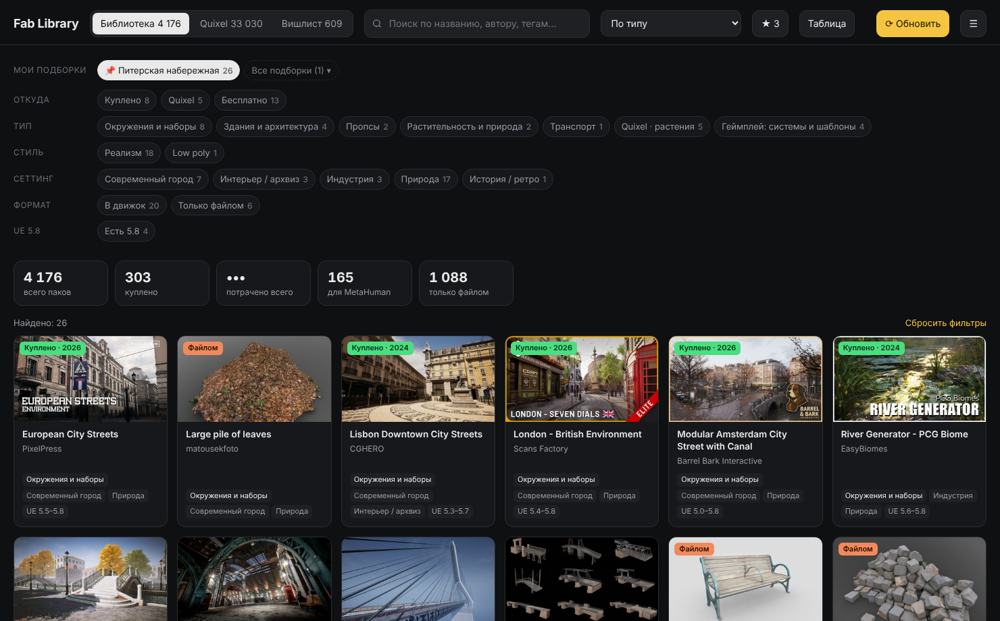
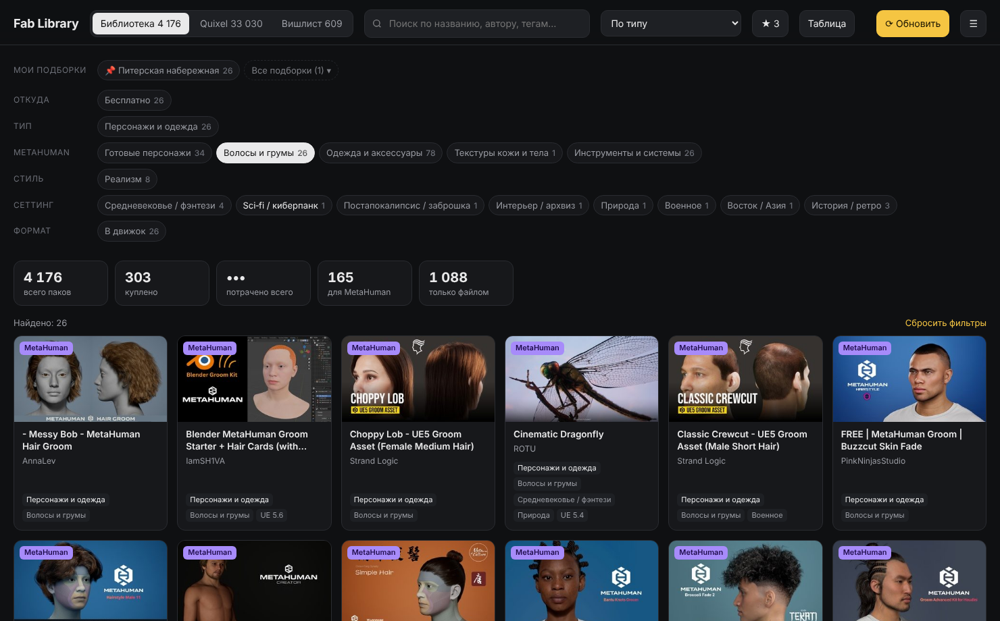
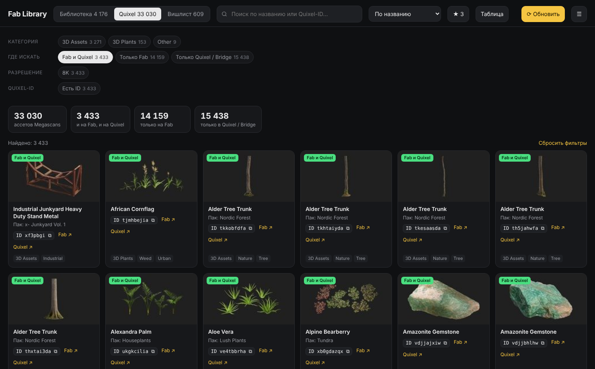
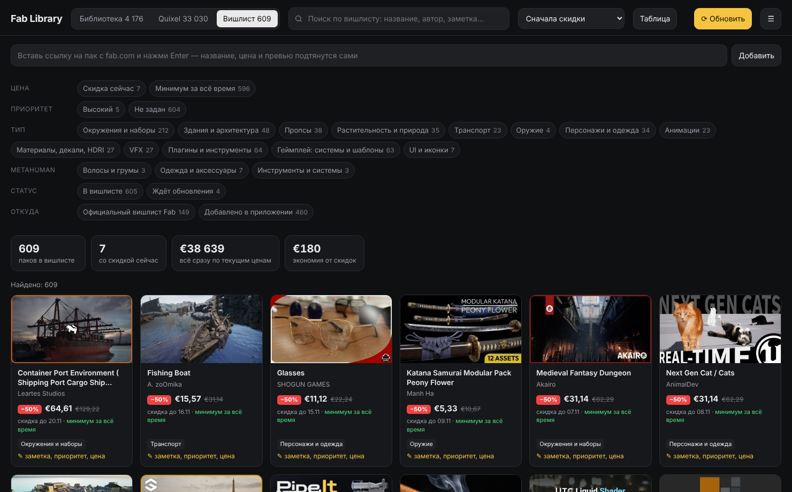

# Fab Library

[English](README.en.md) · Русский

Fab Library — настольное приложение для Windows. Оно собирает все ваши ассеты с Fab.com, старые покупки с Unreal Marketplace, библиотеку Quixel Megascans и вишлист в один офлайн-каталог с фильтрами.



## Зачем это нужно

Я работаю в Unreal Engine, и за несколько лет у меня накопилось больше 4 000 паков на Fab и почти 19 000 ассетов Quixel. Страница My Library на Fab показывает их длинной лентой: по стилю или сеттингу не отфильтруешь, Megascans со старого quixel.com туда не попадают, а официальный вишлист ограничен по размеру. Найти нужный пак под конкретную сцену было долго, поэтому появилось это приложение.

Что оно умеет:

- показывает всю библиотеку Fab, включая паки, купленные ещё на Unreal Marketplace, и считает сумму покупок по истории заказов Epic;
- раскладывает паки по типу, стилю (реализм, стилизация, low poly), сеттингу и формату;
- выделяет всё для MetaHuman: готовых персонажей, волосы и грумы, одежду, текстуры кожи, анимации и инструменты;
- для плагинов показывает, поддерживают ли они последнюю версию движка (сейчас UE 5.8);
- собирает ассеты Quixel со старого quixel.com и с Fab в одну вкладку с категориями как в Bridge. У каждого ассета виден Quixel-ID для поиска в Bridge или на Fab и отметка, где его искать;
- ведёт вишлист без ограничения по размеру. Пак добавляется вставкой ссылки, приложение следит за ценами, скидками и историческим минимумом;
- хранит подборки паков под проекты, например «Питерская набережная»;
- работает без интернета после первой загрузки. Обновление запускается кнопкой.

Интерфейс переведён на русский, английский, испанский, немецкий, французский и китайский.

## Как это выглядит

Подборка под проект:



Ассеты MetaHuman:



Quixel: ассеты, которые есть и на Fab, и на quixel.com:



Вишлист со скидками:



## Установка

Нужен Windows 10 или 11 и около 300 МБ свободного места.

1. Скачайте архив кнопкой Code → Download ZIP на странице репозитория и распакуйте в любую папку, лучше без пробелов в пути, например `D:\FabLibrary`.
2. Запустите `Запуск.bat`. В первый раз скрипт скачает портативный Node.js 22 LTS (около 30 МБ) с nodejs.org, сверит его контрольную сумму и установит Electron (около 100 МБ). Всё ставится внутрь папки приложения, система не меняется. Следующие запуски проходят сразу.
3. Нажмите «Войти в аккаунт и загрузить библиотеку». По очереди откроются окна входа в Fab, в историю покупок Epic и на quixel.com. Логин и пароль вы вводите сами на настоящих сайтах.

Первая загрузка занимает 15–30 минут, следующие пару минут. Если загрузка прервалась, запустите обновление ещё раз, и она продолжится с того же места.

## Как пользоваться

Фильтры на каждой вкладке комбинируются: например, «Персонажи и одежда» + «Реализм» + «Есть 5.8». Клик по Quixel-ID копирует его в буфер обмена. Меню ☰ позволяет сменить язык, включить обновление цен вишлиста при запуске, выгрузить текущий список в CSV и открыть папку с данными.

Подборки хранятся в файле `custom-filters.json` в папке профиля. На виду остаются закреплённые подборки и до трёх новых, остальные спрятаны под кнопкой «Все подборки», где их можно найти, закрепить или удалить. Файл можно править вручную или попросить ИИ-ассистента собрать подборку по описанию (см. следующий раздел): приложение заметит изменение и обновит окно само.

```json
{ "version": 1, "items": [
  { "id": "spb-embankment", "name": "Питерская набережная", "tab": "lib", "pinned": true,
    "created": "2026-11-05", "note": "гранит, мосты, деревья у воды",
    "ids": ["<id листинга Fab>", "<Quixel-ID>"] }
] }
```

`tab` принимает значения `lib`, `qx`, `wish` или `all`.

## Как подключить ИИ-ассистента

Приложение работает и без нейросети. Ассистент полезен, когда нужно найти паки по описанию сцены, посчитать что-то по библиотеке или собрать подборку под проект. Ниже порядок для Claude в приложении для компьютера, с другими ассистентами, которые умеют читать файлы на диске, всё устроено так же.

### Шаг 1. Загрузите библиотеку

Установите приложение и один раз нажмите «Войти в аккаунт и загрузить библиотеку» (см. «Установка»). Пока загрузка не прошла, ассистенту нечего читать.

### Шаг 2. Найдите папку профиля

В приложении откройте меню ☰ → «Открыть папку с данными». Откроется папка вида `C:\Users\<имя>\AppData\Roaming\Fab Library\profiles\<ID аккаунта Epic>`. Скопируйте путь из адресной строки проводника.

Давайте ассистенту доступ только к этой папке. Cookie входа лежат уровнем выше, в `Fab Library\Partitions`, и в папку профиля не попадают. Не давайте доступ ко всей папке `Fab Library`.

### Шаг 3. Дайте доступ к папке

В Claude для компьютера откройте новый чат и попросите открыть папку по скопированному пути. Claude запросит разрешение, подтвердите его. Если ассистент не умеет работать с папками, приложите к сообщению нужные файлы вручную: обычно хватает `library.json`, для вопросов про Quixel добавьте `quixel.json`.

### Шаг 4. Отправьте первое сообщение

Скопируйте текст ниже и вставьте вместо `<путь>` путь к папке профиля. Он объясняет ассистенту, где какие данные и как записывать подборки.

```text
В папке <путь> лежат данные приложения Fab Library — офлайн-каталога моих ассетов Fab и Quixel.
Файлы:
- library.json — мои паки Fab: id, t (название), s (автор), c (категория Fab), tags, lt (тип листинга), ue (версии Unreal Engine), f (форматы);
- purchases.json — история покупок Epic: totals, byYear, items (d — дата, t — название, amt, cur);
- wishlist.json — вишлист: id, t, s, price, dp (цена со скидкой), pct (скидка), hist (история цен);
- quixel.json — ассеты quixel.com: qid (Quixel-ID), t, cat (категория как в Bridge), tags, pack, res;
- megascans-fab.json — Megascans на Fab: id, t, qid, own (true — есть у меня);
- user.json — избранное (fav) и заметки к вишлисту (wish.meta);
- custom-filters.json — мои подборки.
Отвечай по этим файлам и не меняй их, кроме custom-filters.json.
Подборку записывай в custom-filters.json в формате
{ "version": 1, "items": [ { "id": "латиница-через-дефис", "name": "Название", "tab": "lib", "pinned": false, "created": "ГГГГ-ММ-ДД", "note": "коротко, что внутри", "ids": ["id паков"] } ] }.
tab: lib — библиотека (ids из library.json), qx — Quixel (qid или id из megascans-fab.json), wish — вишлист, all — все вкладки.
Существующие подборки не удаляй, новую добавляй в конец items.
```

### Шаг 5. Задавайте вопросы

Примеры запросов:

- «Сделай подборку для набережной в Петербурге: гранит, мосты, деревья у воды»;
- «Какие плагины у меня не поддерживают UE 5.8?»;
- «Сколько я потратил на паки в 2025 году?»;
- «Найди в Quixel мокрый асфальт в 8K и дай Quixel-ID»;
- «Что из вишлиста сейчас со скидкой больше 40%?»;
- «Собери всё для MetaHuman-персонажа в деловом костюме».

Ассистент отвечает по файлам, а подборки записывает в `custom-filters.json`. Если приложение открыто, новая подборка появится сама в строке «Мои подборки» с меткой «новая». Через три дня она уйдёт в список «Все подборки», если её не закрепить звёздочкой.

### Шаг 6. После обновления

Когда вы нажимаете «⟳ Обновить», приложение перезаписывает файлы в папке профиля. Если чат с ассистентом уже открыт, попросите его перечитать файлы, иначе он будет отвечать по старым данным.

## Безопасность и личные данные

- Приложение не видит и не хранит ваши пароли. Вход происходит на страницах Fab, Epic и Quixel внутри окна приложения, после этого остаются только cookie сессии в отдельном профиле Electron.
- Все данные лежат на вашем компьютере в `%APPDATA%\Fab Library\profiles\<ID аккаунта Epic>\`. Приложение никуда их не отправляет, своего сервера у него нет.
- У каждого аккаунта Epic своя папка, поэтому приложение можно отдать другому человеку: он войдёт в свой аккаунт и увидит только свои паки. Пункт меню «Выйти и сменить аккаунт» стирает вход, но не данные.
- Окна сайтов запущены в песочнице без доступа к Node.js, всплывающие окна разрешены только по https, запросы камеры, микрофона и геолокации отклоняются. Ссылки открываются во внешнем браузере, только если это http или https.
- В репозитории нет ничьих данных. Если будете делиться своей копией, не прикладывайте папку `%APPDATA%\Fab Library`: в ней ваша библиотека, вишлист и cookie входа.

## Ограничения

У Fab и Quixel нет публичного API. Приложение делает те же запросы, что сайты делают в вашем браузере, поэтому после крупных изменений на сайтах синхронизация может перестать работать до обновления приложения. Тип, стиль и сеттинг определяются автоматически по тегам и названию и иногда ошибаются.

Epic постепенно переводит Quixel на Fab. Пока quixel.com работает, приложение сохраняет у вас список ваших ассетов с ID, и он остаётся доступен офлайн. Сами файлы ассетов приложение не скачивает.

Это неофициальный проект, он не связан с Epic Games, Fab или Quixel. Используйте его на свой риск и в рамках правил этих сервисов.

## Сборка одного exe-файла

В папке приложения выполните:

```
runtime\node\node.exe runtime\node\node_modules\npm\bin\npm-cli.js run dist
```

Портативный `Fab Library.exe` появится в папке `dist`.

## Устройство

| Файл | Что делает |
|---|---|
| `main.js` | окна, вход, синхронизация, кэш превью, IPC |
| `sync.js` | чтение библиотеки, покупок, вишлиста и Megascans с Fab и Epic |
| `quixel.js` | чтение библиотеки quixel.com |
| `preload.js` | безопасный мост между окном и main-процессом |
| `ui/` | интерфейс: фильтры, карточки, классификация, переводы |
| `tools/get-node.ps1` | загрузка портативного Node.js с проверкой SHA-256 |

Переводы лежат в `ui/i18n.js`, ключом служит русская строка. Чтобы добавить язык, допишите колонку в таблицу строк.

Если хотите собрать похожее приложение сами вместе с Claude, в файле [PROMPT.md](PROMPT.md) лежит готовый запрос.

## Лицензия

MIT, см. [LICENSE](LICENSE).
